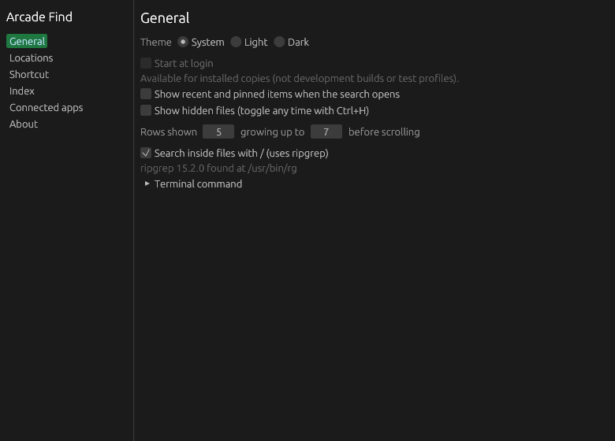

<p align="center">
  
</p>

<h1 align="center">Arcade Find</h1>

<p align="center">Press a shortcut, type, and any file or folder shows up.</p>

<p align="center">
  <a href="https://github.com/qa-p1/Arcade-Find/releases/latest"></a>
  <a href="https://github.com/qa-p1/Arcade-Find/actions/workflows/ci.yml"></a>
</p>

---

Arcade Find opens a local file search with a shortcut. Type a few letters to find files and folders, preview a result, or send it to another Arcade app. It builds a local index of names and metadata and reads file contents only when you search inside files. It is for anyone who wants a fast, keyboard-driven file finder that never sends the index to a server.

It runs on **Linux** (x86_64; Wayland and X11), **Windows** (x64) and **macOS** (universal: Apple Silicon and Intel). Windows and macOS are built and tested in CI only, not verified on a real desktop.

<p align="center"></p>

## Download and install

Download the file for your system from [Releases](https://github.com/qa-p1/Arcade-Find/releases). Or install it from **[Arcade Tools](https://github.com/qa-p1/Arcade-tools) → Apps**, which can also update and remove it.

| Platform | File | How to install |
|---|---|---|
| Linux x86_64 | `Arcade-Find-x86_64.AppImage` | Run it. The first run asks **Install Arcade Find?** and installs to `~/Applications/Arcade/`, adds a menu entry, an `arcade-find` link in `~/.local/bin` and an optional start at login. **Just run it once** skips installing. |
| Windows x64 | `Arcade-Find-<version>-x64-setup.exe` | Run Setup. Installs for your user without admin, adds a Start menu entry and an `arcade-find.cmd` shim in `%LOCALAPPDATA%\Arcade\bin` on the user PATH. |
| macOS (universal) | `Arcade-Find-<version>-universal.dmg` | Open the dmg and drag Arcade Find to Applications. Run from the dmg or Downloads, it offers to move itself to Applications. |

- Scripted Linux install: `Arcade-Find-x86_64.AppImage --install --silent` (add `--no-launch` to not start it, `--channel nightly` to record another channel). `--repair` repoints the launcher and command from a moved AppImage; `--integration-status` prints the integration as JSON without changing anything. A silent install removes the AppImage it was started from only when that file is in your Downloads folder; add `--keep-download` to keep it there too. Files elsewhere are never removed.
- Scripted Windows install: `/VERYSILENT /SUPPRESSMSGBOXES /NORESTART`; `/MERGETASKS=arcade-startup` selects start at login.
- Builds are unsigned. On Windows, SmartScreen may warn: choose **More info → Run anyway**. On macOS the app is not notarized: right-click it and choose **Open** the first time.
- If FUSE is missing on Linux, run the AppImage with `--appimage-extract-and-run`.

See [Getting started](docs/user/getting-started.md) for the full install flow.

## Features

- **Find by name, path or details:** fuzzy, any-order words, path fragments (`src/main`), wildcards (`*.tar.gz`), and filters such as `ext:pdf,docx`, `dir:`/`file:`, `in:~/Projects`, `size:>100mb`, `modified:<7d` and `hidden:yes`.
- **Search inside files:** start a query with `/` (for example `/TODO ext:rs`). This uses ripgrep if it is installed; Find never downloads it.
- **Choose what is indexed:** your home folder by default; add folders and drives in **Settings → Locations** and exclude names or paths. Common build and cache folders, network mounts and system paths are excluded by default, and symbolic links are not followed.
- **Live index:** the first crawl runs in the background and filesystem notifications keep the index current. **Settings → Index** shows index and watcher status and can rescan.
- **Act on results:** preview, open, show in folder, rename (never overwrites), move to Trash after confirmation, copy paths or files, paste files, pin items, and drag results into other apps.
- **Recent and pinned items:** press Down on an empty query.
- **Settings** for theme, start at login, result rows, hidden-file defaults, content search, the global shortcut, locations, exclusions and connected apps.

More in [Features](docs/user/features.md).

## Works with other Arcade apps

Find works on its own. It connects to other installed Arcade apps automatically over Arcade Link, **without needing Arcade Tools**. Turn this on or off with **Connect with other Arcade apps** in Find's Connected apps settings, with a switch per app. Find shows only actions that accept the selected items.

| App | What Find adds or receives |
|---|---|
| Arcade Look | Enter or **Quick Look** previews the selection; if Look cannot handle it, Enter falls back to the default app. |
| Arcade Box | Box tools and presets for the selected files, or a saved Box pipeline. |
| Arcade Shelf | Add selected files or folders to Shelf by reference; Find stays open. Shelf can ask Find to search for an item. |
| Arcade Wheel | Add a selected file or a compatible action to Wheel. |
| Arcade Clipboard | Send selected files or text to your paired devices. |
| Arcade Lens | For an image, Lens analysis or pin actions. Lens can ask Find to search for text or a path. |
| Arcade Tools | Install, update or remove Find from its **Apps** tab. |

Other apps can call `find.search` to get matching paths without opening the overlay, or `find.show` to open Find on a query or item.

When Arcade Tools is running, its tray icon hosts Find's menu (Open Find, Open Settings, Rescan index, Restart, Quit). When Tools quits, Find's own tray icon returns. Turning off **Connect with other Arcade apps** always restores Find's icon.

See [how Find works with other Arcade apps](docs/user/with-other-apps.md) and the [Arcade Link reference](docs/ARCADE_LINK.md).

## Usage

Press **Ctrl+Alt+F** (⌃⌥F on macOS) to show or hide Find. Type, move with the arrow keys and press:

| Key | Action |
|---|---|
| Enter | Preview in Look, or open with the default app |
| Shift+Enter | Open with the default app |
| Ctrl+Enter | Show the item in its folder |
| Tab | Actions for the selection, including connected Arcade apps |
| F2 | Rename |
| Delete | Move to Trash (after confirmation) |
| Ctrl+C / Ctrl+Shift+C | Copy paths / copy files |
| Ctrl+Shift+P | Pin or unpin |
| Ctrl+H | Toggle hidden files |
| Ctrl+, | Settings |

On macOS, Cmd replaces Ctrl. The full list is in the [shortcut reference](docs/user/shortcuts.md), generated from the app's validated shortcut data.

Change the shortcut in **Settings → Shortcut**. On Wayland desktops where Find cannot register a global shortcut, bind `arcade-find --toggle` in the desktop's keyboard settings. See [Hyprland integration](docs/HYPRLAND.md).

### Command line

```
arcade-find [OPTION]

  (no option)          Open the search overlay
  --show [QUERY]       Open the overlay, optionally with a query
  --toggle             Open or close the overlay (bind this to a shortcut)
  --hide               Close the overlay
  --background         Start without showing anything (login)
  --settings           Open Settings
  --search QUERY       Print matching paths (--limit N, --hidden, --json)
  --status             Print the running instance's status as JSON
  --rescan             Rescan all indexed folders
  --restart            Restart the running instance
  --quit               Quit the running instance
  --version            Print the version
  --install            Install this AppImage / macOS bundle
    --silent           Same installation defaults, without a dialog
    --no-launch        Install without starting the installed copy
    --channel C        Receipt channel (default: stable)
  --uninstall          Remove this installation via its receipt
    --silent           Uninstall without a confirmation dialog
    --remove-data      Also remove Find's settings, index, history and pins
  --repair             Repair integration (run from a moved copy to repoint it)
  --integration-status Print integration JSON without changing anything
  --arcade-manifest    Print the Arcade Link manifest
  --arcade-invoke      Serve one Arcade Link request from stdin
```

Environment: `ARCADE_FIND_HOME` (isolated data root), `ARCADE_FIND_PROFILE` (separate profile), `ARCADE_HOME` (Arcade Link locations).

## Settings and data

| | Linux | macOS | Windows |
|---|---|---|---|
| Settings | `~/.config/arcade-find` | `~/Library/Application Support/Arcade Find` | `%APPDATA%\Arcade\Arcade Find` |
| Index and data | `~/.local/share/arcade-find` | `~/Library/Application Support/Arcade Find` | `%LOCALAPPDATA%\Arcade\Arcade Find` |

`ARCADE_FIND_HOME` overrides the data directory and `ARCADE_FIND_PROFILE` selects a separate profile.

Arcade Tools can export Find's locations, exclusions, pins, theme, shortcut and display/search preferences to a settings file and import it into another profile. Imports are validated first, keep a private backup under `backups/` in Find's config folder, and apply live. **Never exported:** the index, recent/history data, start at login, Hyprland policy and connected-app preferences. Paths under your home are stored as `~/`; paths from another OS are skipped.

## Uninstall

- **Linux:** run `arcade-find --uninstall`, use the launcher's **Uninstall** action, or remove Find in Arcade Tools.
- **Windows:** **Settings → Apps** (Apps & features), or Arcade Tools.
- **macOS:** `arcade-find --uninstall` removes the installation recorded in its receipt, or remove Find in Arcade Tools.

Settings, pins, history and the index are kept unless you choose to remove them (`--remove-data`). `--silent` skips the confirmation.

## Platform notes

- **Wayland:** the overlay uses the layer shell where available; on desktops without it (GNOME's path) Find uses a normal floating window. If Find cannot register a global shortcut, bind `arcade-find --toggle`.
- **Hyprland:** Find can add a runtime binding and never edits your Hyprland configuration. See [docs/HYPRLAND.md](docs/HYPRLAND.md).
- **Linux live updates** use inotify. If the system watch limit is too low, Find watches what it can and rescans the rest hourly; the Index page shows the command for raising the limit.
- **Windows** uses ReadDirectoryChangesW plus rescans.
- Find's input does not yet support IME text input or right-to-left text.
- Windows and macOS integration is build/CI only, not verified on a real desktop.

## Build from source

Requires Rust 1.88 or later. On Linux, install the Wayland and XKB development packages:

```sh
sudo apt install libxkbcommon-dev libwayland-dev
```

Build and test:

```sh
cargo build --release -p arcade-find
cargo test --workspace
scripts/e2e-linux.sh target/release/arcade-find
python3 scripts/bench_real.py --files 1000000
```

The end-to-end script needs Sway, grim, wtype, Xvfb and xdotool.

## Documentation

- [User guide](docs/user/): [getting started](docs/user/getting-started.md), [features](docs/user/features.md), [shortcuts](docs/user/shortcuts.md), [FAQ](docs/user/faq.md), [troubleshooting](docs/user/troubleshooting.md)
- [Architecture](docs/ARCHITECTURE.md): index, query, matching and overlay
- [Arcade Link](docs/ARCADE_LINK.md): actions Find exposes and uses
- [Hyprland](docs/HYPRLAND.md): runtime binding and compositor setup
- [Shelf integration](docs/SHELF.md): selection handoff details
- [Status](docs/STATUS.md): verification and known limits
- [Changelog](CHANGELOG.md)
- [Third-party notices](THIRD_PARTY_NOTICES.md) and [vendored files](VENDORED.md)

## License

MIT OR Apache-2.0. See [LICENSE-MIT](LICENSE-MIT) and [LICENSE-APACHE](LICENSE-APACHE).

---

<p align="center">
  Part of the <b>Arcade</b> suite:
  <a href="https://github.com/qa-p1/Arcade-Find">Find</a> ·
  <a href="https://github.com/qa-p1/Arcade-lens">Lens</a> ·
  <a href="https://github.com/qa-p1/Arcade-look">Look</a> ·
  <a href="https://github.com/qa-p1/Arcade-box">Box</a> ·
  <a href="https://github.com/qa-p1/Arcade-clipboard">Clipboard</a> ·
  <a href="https://github.com/qa-p1/Arcade-Shelf">Shelf</a> ·
  <a href="https://github.com/qa-p1/Arcade-wheel">Wheel</a> ·
  <a href="https://github.com/qa-p1/Arcade-tools">Tools</a> ·
  <a href="https://github.com/qa-p1/Arcade-catalog">Docs</a>
</p>
