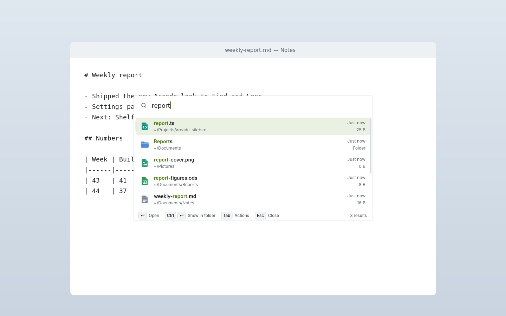
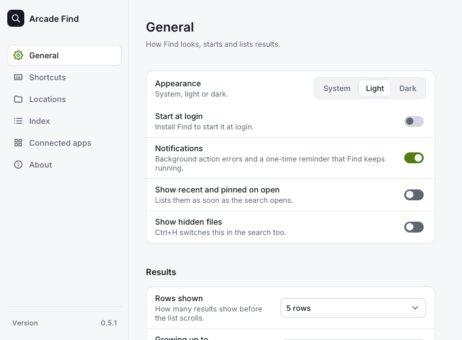

# Arcade Find

Arcade Find searches the names and details of files and folders on your computer. It builds a local index and opens a small search overlay when you press its shortcut.

## Three useful things to start with

- **Find files by name or path:** type a few words, an extension, or part of a folder path.
- **Open and organize results:** preview, open, rename, pin, copy paths, or move files to Trash.
- **Search inside files:** start a query with / to search file contents with ripgrep.

Find does not send your index to a server. It reads file contents only for an explicit content search. See [Features](features.md) and [Troubleshooting](troubleshooting.md).
